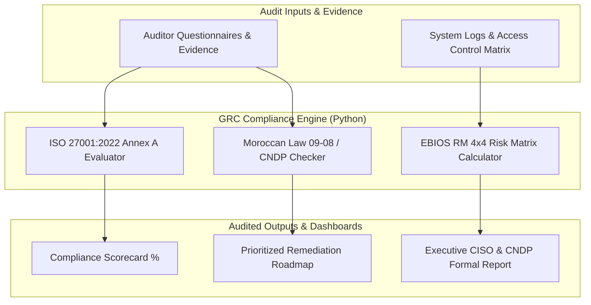

# GRC & Security Audit Compliance Automation Platform

[](https://github.com/Bassma202/grc-compliance-automation-tool/actions)
[](https://opensource.org/licenses/MIT)
[](https://www.python.org/)
[](https://www.iso.org/standard/27001)
[](https://www.cndp.ma/)

> **Automated Governance, Risk & Compliance (GRC) evaluation platform. Operationalizes ISO/IEC 27001:2022 Statement of Applicability (SoA), Moroccan Law 09-08 / CNDP privacy safeguards, and ANSSI EBIOS Risk Manager scoring for healthcare and enterprise environments.**

---

## 1. Executive Overview & Methodology

Originally developed from real-world cybersecurity risk assessment methodologies at **DataPathology** (Casablanca) to audit digital pathology workflows handling highly sensitive patient histology data.

This platform bridges the gap between high-level compliance policies and operational security controls by providing:
1. **ISO/IEC 27001:2022 Assessment Engine:** Evaluates Annex A controls (Organizational, People, Physical, Technological) with weighted gap scoring.
2. **Moroccan Law 09-08 & CNDP Regulatory Compliance:** Audits patient consent, cross-border transfer authorizations, and encryption requirements.
3. **EBIOS Risk Manager Scoring Matrix:** Standardized risk gravity ($1-4$) and likelihood ($1-4$) calculus generating prioritized risk treatment plans.
4. **Automated Executive Reporting:** Generates C-suite Markdown/PDF compliance summaries.



---

## 2. Supported Regulatory & Normative Frameworks

### A. ISO/IEC 27001:2022 (Annex A)
* **A.5 Organizational Controls:** Security policies, asset management, access control governance.
* **A.8 Technological Controls:** Data leakage prevention (A.8.12), logging and monitoring (A.8.15), network security (A.8.20), cryptographic controls (A.8.24).

### B. Moroccan Law 09-08 & CNDP Requirements
* **Article 3:** Lawfulness of processing & explicit patient consent.
* **Article 12:** Specific authorization regimes for sensitive genetic and medical records.
* **Article 23:** Mandatory technical security safeguards against data breaches.
* **Article 24:** Tamper-proof audit trails of user access to medical files.
* **Article 43:** Prior authorization from CNDP for cross-border health data transfers.

---

## 3. Quickstart & Command-Line Usage

### Run an Automated Audit
```bash
# Clone the repository
git clone https://github.com/Bassma202/grc-compliance-automation-tool.git
cd grc-compliance-automation-tool

# Execute compliance audit and export executive report
python3 cli.py --client "Clinique Atlas Pathology Lab" --export-md reports/audit_report.md
```

### Run Unit Tests
```bash
python3 -m unittest discover tests
```

---

## 4. Sample Executive Audit Output

```text
=================================================================
  EXECUTIVE AUDIT SUMMARY FOR: Clinique Atlas Pathology Lab
=================================================================
  ISO/IEC 27001:2022 Score : 73.8% (⚠️ Action Required)
  Moroccan Law 09-08 Score : 80.0% (🚨 1 Regulatory Gap)
  Total Gaps Identified    : 4 ISO Non-conformities / 1 Law 09-08 Gap
=================================================================

Top Priorities:
[HIGH] A.8.12 — Data Leakage Prevention (Status: NOT_IMPLEMENTED)
  -> Deploy endpoint DLP and restrict unsanctioned cloud upload channels.
[CRITICAL] ART-43 — Cross-Border Data Transfer (Status: NON_COMPLIANT)
  -> Cloud backup hosted outside Morocco requires prior CNDP declaration and authorization.
```

---

## 5. Author & Academic Context

* **Author:** **Bassma Alaoui Sossey**  
* **Degree:** Diplôme d'Ingénieur d'État en Cybersécurité  
* **Institution:** Université Euromed de Fès (UEMF), Morocco  
* **Experience Context:** Cybersecurity & Data Protection Intern at DataPathology (Casablanca)
